<div align="center">

# 🚗 Carrent

### Plataforma web para gerenciamento de aluguel de veículos

**Solicite, acompanhe e gerencie aluguéis de automóveis em um único ambiente.**

[](https://carrent-ashy.vercel.app/)


</div>

---

## 🚧 Status do Projeto


O Carrent possui aplicação web publicada e back-end desenvolvido separadamente. A implementação contempla autenticação, gerenciamento de automóveis, pedidos de aluguel, avaliações financeiras, contratos e crédito.

[](https://carrent-ashy.vercel.app/)

---

## 📚 Índice

- [🚗 Carrent](#-carrent)
    - [Plataforma web para gerenciamento de aluguel de veículos](#plataforma-web-para-gerenciamento-de-aluguel-de-veículos)
  - [🚧 Status do Projeto](#-status-do-projeto)
  - [📚 Índice](#-índice)
  - [🔗 Links Úteis](#-links-úteis)
  - [📝 Sobre o Projeto](#-sobre-o-projeto)
    - [Problema que o projeto busca resolver](#problema-que-o-projeto-busca-resolver)
    - [Contexto de utilização](#contexto-de-utilização)
  - [✨ Funcionalidades Principais](#-funcionalidades-principais)
    - [Regras de negócio relevantes](#regras-de-negócio-relevantes)
  - [🛠 Tecnologias Utilizadas](#-tecnologias-utilizadas)
    - [💻 Front-end](#-front-end)
    - [🖥️ Back-end](#️-back-end)
    - [🗄️ Banco de Dados](#️-banco-de-dados)
    - [📱 Mobile](#-mobile)
    - [⚙️ Infraestrutura \& DevOps](#️-infraestrutura--devops)
  - [🏗 Arquitetura](#-arquitetura)
    - [Visão geral da arquitetura](#visão-geral-da-arquitetura)
    - [Diagramas](#diagramas)
    - [Fluxo de funcionamento](#fluxo-de-funcionamento)
    - [Decisões arquiteturais](#decisões-arquiteturais)
  - [🔧 Instalação e Execução](#-instalação-e-execução)
    - [Pré-requisitos](#pré-requisitos)
    - [🔑 Variáveis de Ambiente](#-variáveis-de-ambiente)
      - [1. Back-end (Spring Boot)](#1-back-end-spring-boot)
      - [2. Front-end (React, Vite)](#2-front-end-react-vite)
      - [3. Variáveis de Ambiente na Vercel](#3-variáveis-de-ambiente-na-vercel)
      - [4. Variáveis de Ambiente no Back-end em Produção](#4-variáveis-de-ambiente-no-back-end-em-produção)
    - [📦 Instalação de Dependências](#-instalação-de-dependências)
      - [1. Clone o repositório](#1-clone-o-repositório)
      - [2. Front-end (React)](#2-front-end-react)
      - [3. Back-end (Spring Boot)](#3-back-end-spring-boot)
    - [💾 Inicialização do Banco de Dados (PostgreSQL / Supabase)](#-inicialização-do-banco-de-dados-postgresql--supabase)
    - [⚡ Como Executar a Aplicação](#-como-executar-a-aplicação)
      - [Terminal 1: Back-end (Spring Boot)](#terminal-1-back-end-spring-boot)
      - [Terminal 2: Front-end (React, Vite)](#terminal-2-front-end-react-vite)
    - [🐳 Execução com Docker](#-execução-com-docker)
  - [🚀 Deploy](#-deploy)
    - [1. Build do Front-end](#1-build-do-front-end)
    - [2. Build do Back-end](#2-build-do-back-end)
    - [3. Deploy do Front-end na Vercel](#3-deploy-do-front-end-na-vercel)
    - [4. Deploy do Back-end](#4-deploy-do-back-end)
  - [📂 Estrutura de Pastas](#-estrutura-de-pastas)
  - [🎥 Demonstração](#-demonstração)
    - [📱 Aplicativo Mobile](#-aplicativo-mobile)
    - [🌐 Aplicação Web](#-aplicação-web)
    - [💻 Exemplo de Saída no Terminal (para Back-end / API)](#-exemplo-de-saída-no-terminal-para-back-end--api)
      - [1. Demonstração da API (exemplo com cURL)](#1-demonstração-da-api-exemplo-com-curl)
      - [2. Principais endpoints identificados](#2-principais-endpoints-identificados)
  - [🧪 Testes](#-testes)
    - [Testes Unitários e de Integração](#testes-unitários-e-de-integração)
    - [Verificação do Front-end](#verificação-do-front-end)
    - [Testes End-to-End (E2E)](#testes-end-to-end-e2e)
  - [🔗 Documentações utilizadas](#-documentações-utilizadas)
  - [👥 Autores](#-autores)
  - [🤝 Contribuição](#-contribuição)
    - [Boas práticas](#boas-práticas)
  - [🙏 Agradecimentos](#-agradecimentos)
  - [📄 Licença](#-licença)

---

## 🔗 Links Úteis

- 🌐 **Demo Online:** [Acesse o Carrent](https://carrent-ashy.vercel.app/)
  - Aplicação web hospedada na Vercel.
- 📖 **Modelagem e documentação:** [Diagramas e histórias de usuário](./docs/)
  - Consulte os documentos de modelagem, histórias de usuário e diagramas UML disponíveis no diretório `docs`.
- 🧩 **Front-end:** [`frontend/`](./frontend/)
- ⚙️ **Back-end:** [`backend/`](./backend/)

> O projeto não possui aplicativo mobile nativo. A interface disponibilizada é uma aplicação web.

---

## 📝 Sobre o Projeto

O **Carrent** é um sistema web destinado ao gerenciamento do processo de aluguel de automóveis. A plataforma organiza a interação entre clientes e agentes responsáveis pela análise das solicitações, permitindo acompanhar as etapas desde o cadastro do pedido até a formalização do contrato.

O projeto busca centralizar informações que participam de uma locação, como dados do cliente, automóveis, pedidos, avaliações financeiras, contratos e concessões de crédito.

### Problema que o projeto busca resolver

O processo de aluguel envolve diferentes participantes e etapas que precisam estar relacionadas: solicitação do veículo, análise das informações do contratante, decisão financeira e formalização do aluguel. O Carrent propõe um ambiente integrado para registrar e acompanhar essas operações, reduzindo a fragmentação das informações.

### Contexto de utilização

O sistema contempla os seguintes perfis:

- **Cliente:** realiza cadastro, consulta automóveis, solicita aluguéis, acompanha avaliações e consulta contratos.
- **Agente:** representa as organizações responsáveis por consultar e avaliar pedidos.
- **Empresa:** atua como agente avaliador e pode ser proprietária de automóveis.
- **Banco:** atua como agente e possui a responsabilidade adicional de conceder crédito.

O projeto foi desenvolvido como aplicação web, com front-end em React e back-end em Spring Boot, utilizando PostgreSQL disponibilizado pelo Supabase.

---

## ✨ Funcionalidades Principais

- 🔐 **Cadastro e autenticação:** criação de conta, login e encerramento de sessão.
- 👤 **Gerenciamento de perfil:** consulta e atualização dos dados do usuário e das informações do contratante.
- 🚘 **Gerenciamento de automóveis:** consulta de veículos e cadastro por agentes.
- 📋 **Pedidos de aluguel:** criação, consulta, atualização e cancelamento de solicitações.
- 🔎 **Acompanhamento de pedidos:** consulta dos detalhes e do status das solicitações.
- 📊 **Avaliação financeira:** registro e consulta do histórico de avaliações vinculadas aos pedidos.
- 📄 **Contratos:** formalização e consulta de contratos de aluguel.
- 💳 **Concessão de crédito:** registro de crédito associado a um contrato por um banco.
- 🧾 **Informações do contratante:** cadastro de dados pessoais e profissionais, incluindo vínculos empregatícios e rendimentos.

### Regras de negócio relevantes

- É necessário estar autenticado para utilizar as funcionalidades protegidas.
- Um cliente pode gerenciar seus próprios pedidos.
- Um pedido deve passar por avaliação financeira.
- Somente pedidos com parecer financeiro positivo podem avançar para a contratação.
- Um aluguel pode possuir um contrato de crédito associado.
- O crédito deve ser concedido por um banco.
- Um automóvel pode pertencer a um cliente, empresa ou banco.
- Um contratante pode possuir até três vínculos empregatícios.

---

## 🛠 Tecnologias Utilizadas

As tecnologias abaixo foram identificadas nos arquivos de configuração e no código-fonte do projeto.

### 💻 Front-end

| Tecnologia | Utilização |
|---|---|
| [React 19](https://react.dev/) | Construção da interface por componentes. |
| [TypeScript 7](https://www.typescriptlang.org/) | Tipagem estática da aplicação. |
| [Vite 8](https://vite.dev/) | Servidor de desenvolvimento e ferramenta de build. |
| [Tailwind CSS 4](https://tailwindcss.com/) | Estilização da interface. |
| [React Router 7](https://reactrouter.com/) | Navegação e gerenciamento de rotas. |
| [Lucide React](https://lucide.dev/) | Biblioteca de ícones. |
| [Oxlint](https://oxc.rs/docs/guide/usage/linter.html) | Análise estática e lint do código. |

### 🖥️ Back-end

| Tecnologia | Utilização |
|---|---|
| [Java 25](https://www.oracle.com/java/) | Linguagem de programação. |
| [Spring Boot 4.1.2](https://spring.io/projects/spring-boot) | Framework da aplicação back-end. |
| [Spring Web MVC](https://docs.spring.io/spring-framework/reference/web/webmvc.html) | Exposição dos endpoints REST. |
| [Spring Data JPA](https://spring.io/projects/spring-data-jpa) | Persistência e acesso a dados. |
| [Spring Security](https://spring.io/projects/spring-security) | Autenticação e proteção dos endpoints. |
| [Jakarta Validation](https://beanvalidation.org/) | Validação dos dados recebidos. |
| [Lombok](https://projectlombok.org/) | Redução de código repetitivo. |
| [Maven](https://maven.apache.org/) | Gerenciamento de dependências e build. |

### 🗄️ Banco de Dados

| Tecnologia | Utilização |
|---|---|
| [PostgreSQL](https://www.postgresql.org/) | Banco de dados relacional. |
| [Supabase](https://supabase.com/) | Hospedagem e disponibilização do PostgreSQL. |
| [Hibernate](https://hibernate.org/orm/) | Implementação ORM utilizada pelo JPA. |

### 📱 Mobile

Não há aplicação mobile nativa neste projeto. O produto é disponibilizado como aplicação web.

### ⚙️ Infraestrutura & DevOps

| Tecnologia | Utilização |
|---|---|
| [Vercel](https://vercel.com/) | Hospedagem do front-end. |
| [Supabase](https://supabase.com/) | Serviço de banco de dados PostgreSQL. |
| [Docker](https://www.docker.com/) | Containerização do back-end, com Dockerfile próprio. |
| [Maven Wrapper](https://maven.apache.org/wrapper/) | Execução do Maven sem exigir instalação global. |

---

## 🏗 Arquitetura

### Visão geral da arquitetura

O Carrent utiliza uma arquitetura web cliente-servidor, com separação entre front-end e back-end. O front-end é responsável pela interface e pela interação com o usuário, enquanto o back-end concentra as regras de negócio, autenticação, validações e persistência.

O back-end segue a organização em camadas inspirada no padrão **MVC (Model-View-Controller)**, com responsabilidades distribuídas entre controllers, services, repositories e objetos de domínio.

**Front-end - React**

- `pages`: telas e rotas da aplicação.
- `components`: componentes reutilizáveis, organizados por contexto funcional.
- `services`: comunicação HTTP com a API.
- `context` e `hooks`: contexto de autenticação e hooks reutilizáveis.
- `types`: contratos e tipos utilizados na aplicação.
- `utils`: funções auxiliares.

**Back-end - Spring Boot**

- `controller`: recebe requisições HTTP e disponibiliza os endpoints REST.
- `service`: implementa as regras de negócio.
- `repository`: abstrai o acesso e a persistência dos dados.
- `domain`: contém as entidades e conceitos do domínio.
- `dto`: define os objetos de transferência de dados.
- `security`: concentra os mecanismos de autenticação e proteção.
- `config`: configurações de CORS e integração com o Supabase.

**Banco de dados - PostgreSQL**

O PostgreSQL armazena os dados de usuários, automóveis, pedidos, avaliações, contratos e créditos. A conexão é configurada no back-end por meio de variáveis de ambiente.

### Diagramas

Os diagramas abaixo são os arquivos presentes no diretório `docs/diagrams` do projeto.

| Diagrama de Casos de Uso | Diagrama de Classes |
|:---:|:---:|
| 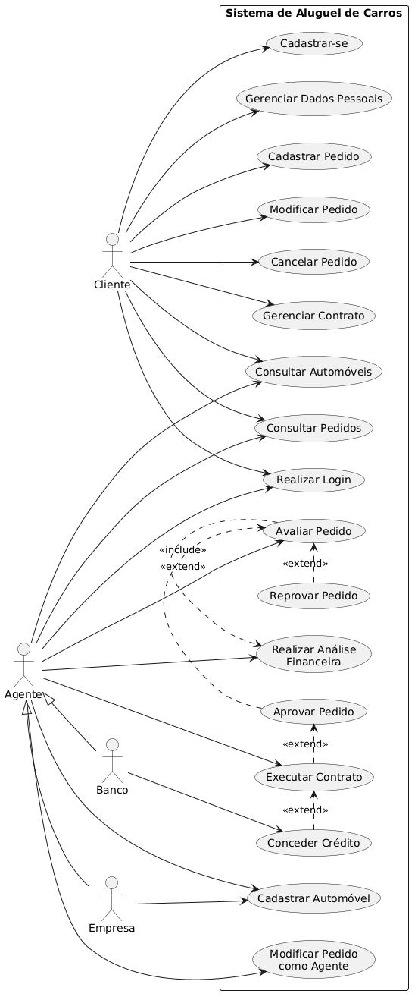 | 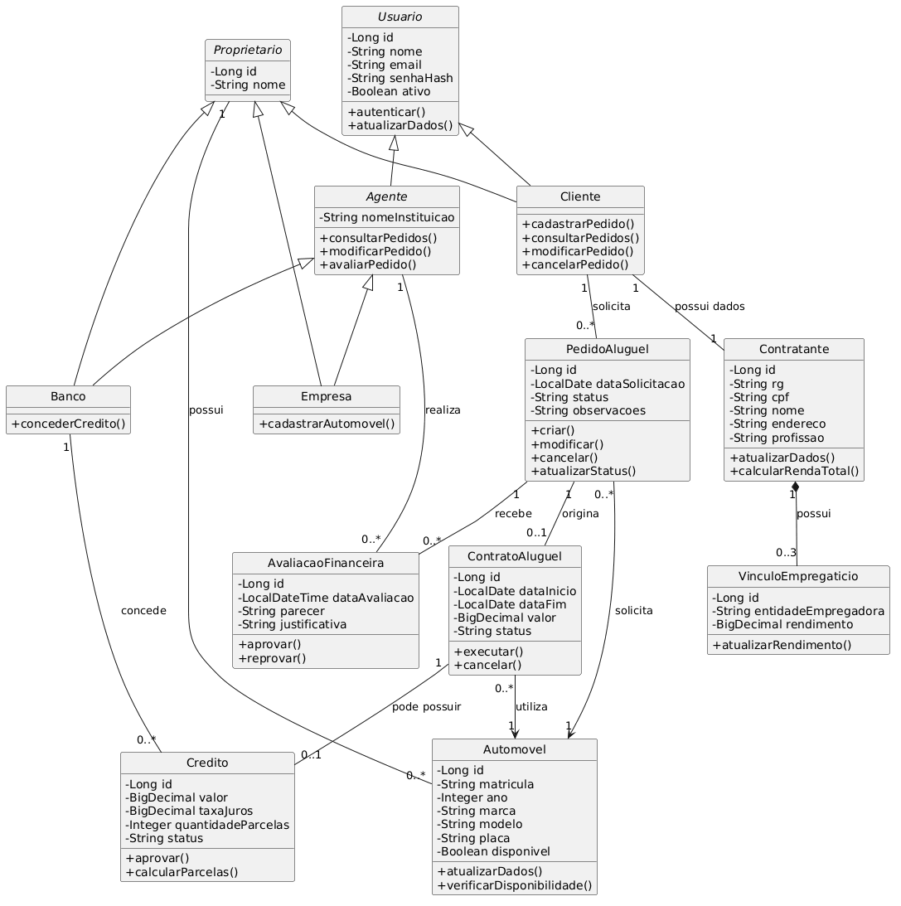 |
| [Visualizar arquivo](./docs/diagrams/use-case.png) | [Visualizar arquivo](./docs/diagrams/uml.png) |

| Diagrama de Pacotes |
|:---:|
| 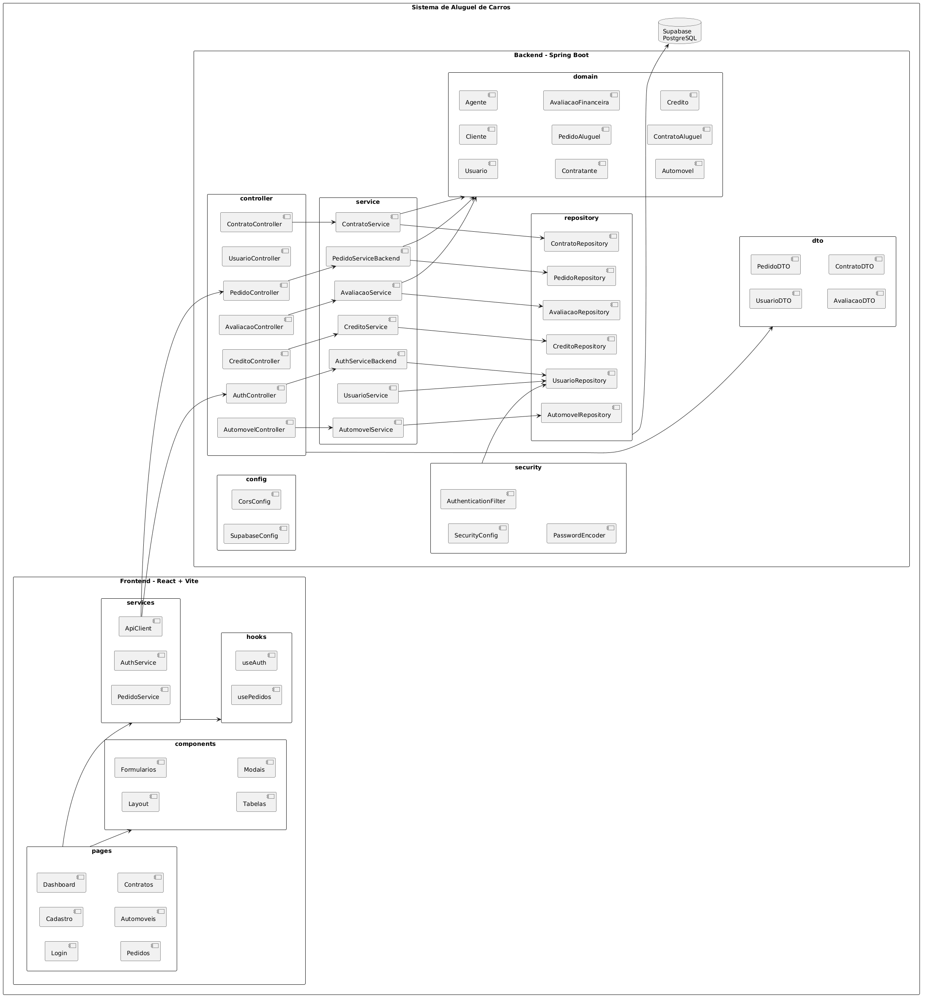 |
| [Visualizar arquivo](./docs/diagrams/package.png) |

### Fluxo de funcionamento

O fluxo principal de uma solicitação de aluguel pode ser resumido nas seguintes etapas:

1. O usuário realiza cadastro e autenticação.
2. O cliente consulta os automóveis disponíveis.
3. O cliente registra um pedido de aluguel.
4. O agente consulta o pedido e os dados do contratante.
5. O agente registra uma avaliação financeira.
6. Caso o parecer seja positivo, o pedido pode avançar para a formalização do contrato.
7. Quando aplicável, um banco pode conceder crédito associado ao contrato.
8. O cliente e os agentes podem consultar as informações relacionadas às solicitações e aos contratos, respeitando as permissões do sistema.

### Decisões arquiteturais

- **Separação entre front-end e back-end:** permite desenvolver, executar e publicar as aplicações de forma independente.
- **API REST:** estabelece a comunicação entre a interface React e o Spring Boot por meio de requisições HTTP.
- **Camada de serviços:** mantém as regras de negócio fora dos controllers.
- **Repositories:** isolam a lógica de acesso aos dados.
- **DTOs:** controlam os dados recebidos e enviados pela API.
- **Spring Security:** centraliza a proteção dos recursos e a autenticação.
- **PostgreSQL:** oferece persistência relacional para as entidades do domínio.

---

## 🔧 Instalação e Execução

### Pré-requisitos

Antes de executar o projeto, certifique-se de possuir:

- **Java JDK 25:** necessário para compilar e executar o back-end.
- **Node.js:** versão compatível com Vite 8 (Node.js 20.19+ ou 22.12+).
- **npm:** gerenciador de pacotes do front-end.
- **Git:** para clonar o repositório.
- **PostgreSQL/Supabase:** instância de banco de dados acessível.
- **Docker:** opcional, para executar o back-end em container.

> O projeto inclui Maven Wrapper (`mvnw` e `mvnw.cmd`), portanto não é necessário instalar o Maven globalmente.

### 🔑 Variáveis de Ambiente

As configurações do projeto são carregadas por variáveis de ambiente. O back-end também importa um arquivo `.env` no formato de propriedades, conforme `spring.config.import=optional:file:.env[.properties]`.

#### 1. Back-end (Spring Boot)

Crie um arquivo `.env` na pasta `backend`, utilizando como referência `backend/.env.example`.

| Variável | Descrição | Exemplo |
|---|---|---|
| `SPRING_PROFILES_ACTIVE` | Perfil de execução do Spring. | `dev` ou `prod` |
| `PORT` | Porta HTTP do back-end. | `8080` |
| `DB_URL` | URL JDBC de conexão com PostgreSQL. | `jdbc:postgresql://localhost:5432/carrent` |
| `DB_USERNAME` | Usuário do banco de dados. | `postgres` |
| `DB_PASSWORD` | Senha do banco de dados. | `sua_senha` |
| `JPA_DDL_AUTO` | Estratégia de atualização do schema JPA. | `update` |
| `DB_POOL_MAX` | Tamanho máximo do pool de conexões. | `5` |
| `TOKEN_SECRET` | Segredo utilizado na configuração de segurança. | `uma_chave_longa_e_segura` |
| `TOKEN_EXPIRATION_MINUTES` | Tempo de expiração do token em minutos. | `480` |
| `CORS_ALLOWED_ORIGINS` | Origens permitidas para requisições CORS. | `http://localhost:5173` |
| `SEED_BANCO_NOME` | Nome do usuário inicial do tipo banco. | `Banco Carrent` |
| `SEED_BANCO_EMAIL` | E-mail do usuário inicial do tipo banco. | `banco@carrent.dev` |
| `SEED_BANCO_SENHA` | Senha do usuário inicial do tipo banco. | `defina_uma_senha` |
| `SEED_EMPRESA_NOME` | Nome do usuário inicial do tipo empresa. | `Empresa Carrent` |
| `SEED_EMPRESA_EMAIL` | E-mail do usuário inicial do tipo empresa. | `empresa@carrent.dev` |
| `SEED_EMPRESA_SENHA` | Senha do usuário inicial do tipo empresa. | `defina_uma_senha` |

Exemplo de arquivo `backend/.env` para desenvolvimento local:

```properties
SPRING_PROFILES_ACTIVE=dev
PORT=8080

DB_URL=jdbc:postgresql://localhost:5432/carrent
DB_USERNAME=postgres
DB_PASSWORD=sua_senha

JPA_DDL_AUTO=update
DB_POOL_MAX=5
TOKEN_EXPIRATION_MINUTES=480

CORS_ALLOWED_ORIGINS=http://localhost:5173

# Segredo de desenvolvimento. Substitua por um valor seguro.
TOKEN_SECRET=uma_chave_longa_e_segura_para_desenvolvimento
```

As variáveis de seed podem ser configuradas conforme necessário. O perfil `dev` possui valores padrão para os usuários iniciais; em produção, as variáveis correspondentes devem ser informadas.

> **Atenção:** não versione arquivos `.env` nem compartilhe senhas, credenciais do Supabase ou segredos de autenticação. O perfil `prod` exige `TOKEN_SECRET` e as configurações de seed correspondentes.

#### 2. Front-end (React, Vite)

Crie um arquivo `.env` ou `.env.local` na pasta `frontend`, tomando como base `frontend/.env.example`.

| Variável | Descrição | Exemplo |
|---|---|---|
| `VITE_API_URL` | URL base do back-end, sem `/api` no final. | `http://localhost:8080` |

Exemplo de `frontend/.env.local`:

```env
VITE_API_URL=http://localhost:8080
```

Para produção, configure a variável `VITE_API_URL` com a URL pública do back-end no ambiente de hospedagem do front-end.

> **Observação:** variáveis com prefixo `VITE_` são incorporadas ao código disponibilizado no navegador. Não coloque senhas ou segredos privados nessas variáveis.

#### 3. Variáveis de Ambiente na Vercel

Para configurar o front-end na Vercel:

1. Acesse o projeto no [painel da Vercel](https://vercel.com/dashboard).
2. Entre em **Settings > Environment Variables**.
3. Adicione a variável `VITE_API_URL`.
4. Informe a URL pública do back-end, sem `/api` no final.
5. Selecione os ambientes em que a variável será utilizada.
6. Salve e faça um novo deploy para aplicar a configuração.

Exemplo:

```env
VITE_API_URL=https://sua-api-publicada.com
```

A URL acima é ilustrativa: substitua pelo endereço real do serviço de back-end.

#### 4. Variáveis de Ambiente no Back-end em Produção

No provedor responsável pelo back-end, configure as variáveis abaixo:

```env
SPRING_PROFILES_ACTIVE=prod
PORT=8080

DB_URL=jdbc:postgresql://SEU_HOST:5432/postgres
DB_USERNAME=SEU_USUARIO
DB_PASSWORD=SUA_SENHA

JPA_DDL_AUTO=update
DB_POOL_MAX=5
TOKEN_EXPIRATION_MINUTES=480

TOKEN_SECRET=SEU_SEGREDO_FORTE
CORS_ALLOWED_ORIGINS=https://carrent-ashy.vercel.app

SEED_BANCO_NOME=Banco Carrent
SEED_BANCO_EMAIL=banco@seu-dominio.com
SEED_BANCO_SENHA=SENHA_SEGURA

SEED_EMPRESA_NOME=Empresa Carrent
SEED_EMPRESA_EMAIL=empresa@seu-dominio.com
SEED_EMPRESA_SENHA=SENHA_SEGURA
```

Ajuste `PORT` conforme a porta disponibilizada pelo provedor e utilize as credenciais reais do projeto Supabase. Não utilize os valores ilustrativos em produção.

### 📦 Instalação de Dependências

#### 1. Clone o repositório

```bash
git clone <URL_DO_REPOSITORIO>
cd carrent-main
```

#### 2. Front-end (React)

```bash
cd frontend
npm install
```

#### 3. Back-end (Spring Boot)

No Windows:

```powershell
cd ..\backend
.\mvnw.cmd clean install
```

No Linux ou macOS:

```bash
cd ../backend
chmod +x mvnw
./mvnw clean install
```

O Maven Wrapper fará o download da distribuição necessária e resolverá as dependências declaradas no `pom.xml`.

### 💾 Inicialização do Banco de Dados (PostgreSQL / Supabase)

O Carrent utiliza PostgreSQL. O projeto possui configuração de conexão com Supabase no back-end.

**Opção 1 - Utilizar Supabase**

1. Acesse o [Supabase](https://supabase.com/).
2. Crie ou selecione um projeto.
3. Acesse as informações de conexão do banco de dados.
4. Copie host, porta, nome do banco, usuário e senha.
5. Monte a URL JDBC e configure `DB_URL`, `DB_USERNAME` e `DB_PASSWORD` no arquivo `backend/.env`.

Exemplo de URL JDBC:

```properties
DB_URL=jdbc:postgresql://SEU_HOST:5432/postgres
```

**Opção 2 - Utilizar PostgreSQL local com Docker**

Caso prefira executar um banco local:

```bash
docker run --name carrent-db \
  -e POSTGRES_USER=postgres \
  -e POSTGRES_PASSWORD=sua_senha \
  -e POSTGRES_DB=carrent \
  -p 5432:5432 \
  -d postgres:16
```

Configure o back-end:

```properties
DB_URL=jdbc:postgresql://localhost:5432/carrent
DB_USERNAME=postgres
DB_PASSWORD=sua_senha
```

O projeto utiliza Spring Data JPA/Hibernate. A propriedade `JPA_DDL_AUTO` controla a estratégia de geração/atualização do schema; no exemplo de desenvolvimento, o valor padrão é `update`.

### ⚡ Como Executar a Aplicação

Execute o back-end e o front-end em terminais separados.

#### Terminal 1: Back-end (Spring Boot)

Na raiz do repositório:

**Windows:**

```powershell
cd backend
.\mvnw.cmd spring-boot:run
```

**Linux/macOS:**

```bash
cd backend
./mvnw spring-boot:run
```

A API ficará disponível, por padrão, em:

```text
http://localhost:8080
```

#### Terminal 2: Front-end (React, Vite)

Na raiz do repositório:

```bash
cd frontend
npm run dev
```

A aplicação web ficará disponível, por padrão, em:

```text
http://localhost:5173
```

Certifique-se de que `VITE_API_URL` aponta para o endereço em que o back-end está sendo executado.

### 🐳 Execução com Docker

O back-end possui um `Dockerfile` próprio, com build Maven em múltiplas etapas e imagem final baseada em Java 25.

Na raiz do repositório:

```bash
docker build -t carrent-backend ./backend
```

Execute o container informando as variáveis necessárias:

```bash
docker run --name carrent-backend \
  -p 8080:8080 \
  -e PORT=8080 \
  -e SPRING_PROFILES_ACTIVE=prod \
  -e DB_URL="jdbc:postgresql://SEU_HOST:5432/postgres" \
  -e DB_USERNAME="SEU_USUARIO" \
  -e DB_PASSWORD="SUA_SENHA" \
  -e TOKEN_SECRET="SEU_SEGREDO_FORTE" \
  -e CORS_ALLOWED_ORIGINS="http://localhost:5173" \
  carrent-backend
```

> **Importante:** não há uma configuração Compose pronta para iniciar front-end, back-end e banco de dados em conjunto. O Dockerfile existente é específico do back-end.

---

## 🚀 Deploy

O front-end do Carrent está publicado na Vercel. O back-end é uma aplicação Spring Boot independente e precisa estar disponível em um serviço que execute Java 25 ou a imagem Docker fornecida.

### 1. Build do Front-end

```bash
cd frontend
npm install
npm run build
```

O Vite gera os arquivos estáticos de produção no diretório `frontend/dist`.

### 2. Build do Back-end

Na pasta `backend`:

**Windows:**

```powershell
.\mvnw.cmd clean package
```

**Linux/macOS:**

```bash
./mvnw clean package
```

O artefato executável é gerado em:

```text
backend/target/carrent-0.0.1-SNAPSHOT.jar
```

Para executar o JAR:

```bash
java -jar target/carrent-0.0.1-SNAPSHOT.jar
```

### 3. Deploy do Front-end na Vercel

1. Importe o repositório no painel da Vercel.
2. Configure `frontend` como **Root Directory**.
3. Utilize `npm install` como comando de instalação.
4. Utilize `npm run build` como comando de build.
5. Configure `dist` como diretório de saída.
6. Cadastre `VITE_API_URL` com a URL pública do back-end.
7. Realize o deploy.

A aplicação publicada pode ser acessada em [https://carrent-ashy.vercel.app/](https://carrent-ashy.vercel.app/).

### 4. Deploy do Back-end

O back-end pode ser publicado em um provedor compatível com Java 25 ou Docker.

Para utilizar o Dockerfile existente:

1. Configure `backend` como contexto de build.
2. Construa a imagem a partir de `backend/Dockerfile`.
3. Configure as variáveis de ambiente de produção.
4. Disponibilize a conexão com o PostgreSQL/Supabase.
5. Configure a porta disponibilizada pelo provedor.
6. Atualize `CORS_ALLOWED_ORIGINS` com o domínio do front-end.
7. Atualize `VITE_API_URL` na Vercel com a URL pública da API e gere um novo deploy.

> **Atenção:** o deploy do front-end não disponibiliza automaticamente a API. O back-end precisa estar publicado e acessível para que as operações que dependem de persistência funcionem no ambiente de produção.

---

## 📂 Estrutura de Pastas

A estrutura abaixo representa os principais diretórios e arquivos encontrados no projeto.

```text
carrent-main/
│
├── README.md
│
├── backend/                         # Aplicação Java / Spring Boot
│   ├── .env.example                 # Modelo das variáveis do back-end
│   ├── Dockerfile                   # Build e execução em container
│   ├── mvnw                         # Maven Wrapper (Linux/macOS)
│   ├── mvnw.cmd                     # Maven Wrapper (Windows)
│   ├── pom.xml                      # Dependências e configuração Maven
│   │
│   └── src/
│       ├── main/
│       │   ├── java/br/com/carrent/
│       │   │   ├── config/          # CORS e configuração Supabase
│       │   │   ├── controller/      # Endpoints REST
│       │   │   ├── domain/          # Entidades e domínio
│       │   │   ├── dto/             # Objetos de transferência
│       │   │   ├── repository/      # Persistência e consultas
│       │   │   ├── security/        # Autenticação e segurança
│       │   │   ├── service/         # Regras de negócio
│       │   │   └── CarrentApplication.java
│       │   │
│       │   └── resources/
│       │       ├── application.properties
│       │       ├── application-dev.properties
│       │       └── application-prod.properties
│       │
│       └── test/                    # Testes do back-end
│
├── frontend/                        # Aplicação React
│   ├── .env.example                 # Modelo das variáveis do front-end
│   ├── package.json                 # Dependências e scripts
│   ├── package-lock.json            # Lockfile npm
│   ├── index.html
│   ├── public/
│   │   └── favicon.svg
│   │
│   └── src/
│       ├── components/
│       │   ├── automovel/           # Componentes de automóveis
│       │   ├── contrato/            # Componentes de contratos e crédito
│       │   ├── layout/              # Layouts e proteção de rotas
│       │   ├── pedido/              # Componentes de pedidos e avaliações
│       │   ├── ui/                  # Componentes visuais reutilizáveis
│       │   └── usuario/             # Componentes de usuário/contratante
│       │
│       ├── context/                 # Contexto de autenticação
│       ├── hooks/                   # Hooks personalizados
│       ├── pages/                   # Páginas e rotas
│       ├── services/                # Comunicação com a API
│       ├── types/                   # Tipos e contratos
│       ├── utils/                   # Funções utilitárias
│       ├── App.tsx                  # Configuração das rotas
│       ├── index.css                # Estilos globais
│       └── main.tsx                 # Ponto de entrada
│
└── docs/                            # Documentação do projeto
    ├── MODELING.md                  # Modelagem e regras de negócio
    ├── USER_STORIES.MD              # Histórias de usuário
    └── diagrams/
        ├── package.png              # Diagrama de pacotes
        ├── uml.png                  # Diagrama de classes
        └── use-case.png             # Diagrama de casos de uso
```

---

## 🎥 Demonstração

A aplicação está disponível publicamente:

**[🚗 Acessar Carrent - https://carrent-ashy.vercel.app/](https://carrent-ashy.vercel.app/)**

### 📱 Aplicativo Mobile

O Carrent não possui aplicativo mobile nativo. A demonstração é realizada pela aplicação web, que pode ser acessada por navegadores em dispositivos compatíveis.

### 🌐 Aplicação Web

A aplicação reúne as telas de autenticação, consulta e gerenciamento de automóveis, pedidos, contratos e perfil.

| Tela | Rota |
|:---:|:---|
| **Login** | `/login` |
| **Cadastro** | `/cadastro` |
| **Automóveis** | `/automoveis` |
| **Pedidos** | `/pedidos` |
| **Detalhes do pedido** | `/pedidos/:id` |
| **Contratos** | `/contratos` |
| **Detalhes do contrato** | `/contratos/:id` |
| **Perfil** | `/perfil` |

As rotas protegidas exigem autenticação. A rota inicial direciona o usuário para o perfil quando o cadastro do contratante precisa ser completado ou para a área de pedidos nos demais casos.

As capturas de tela da aplicação devem ficar centralizadas em docs/images/. Os arquivos abaixo seguem os nomes padronizados utilizados nesta documentação:

| Tela | Captura |
|---|---|
| Login | 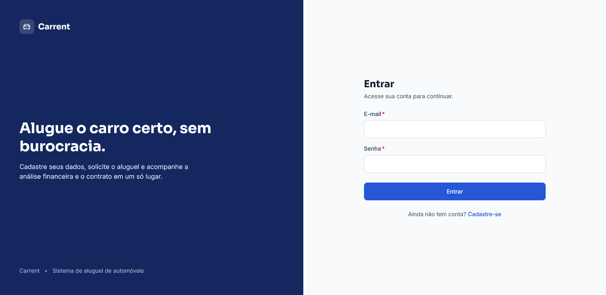 |
| Cadastro | 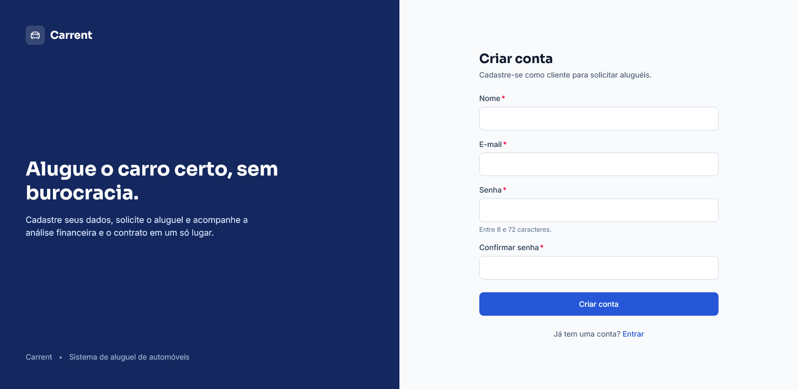 |
| Automóveis | 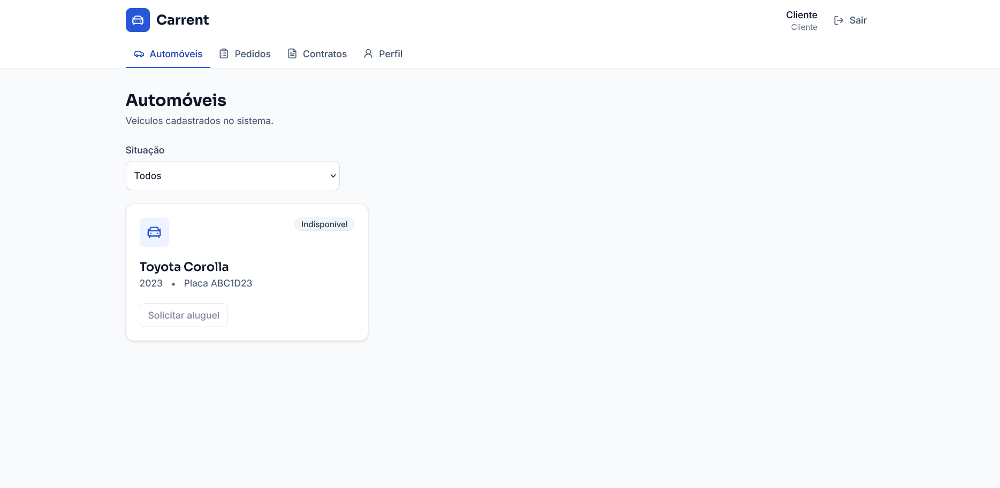 |
| Pedidos | 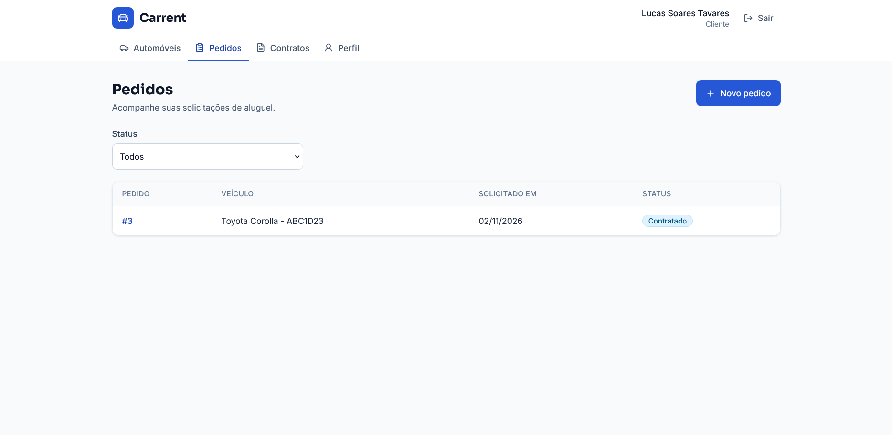 |
| Detalhes do pedido | 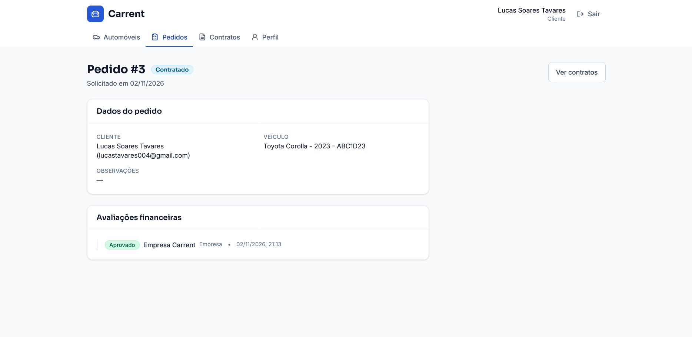 |
| Contratos | 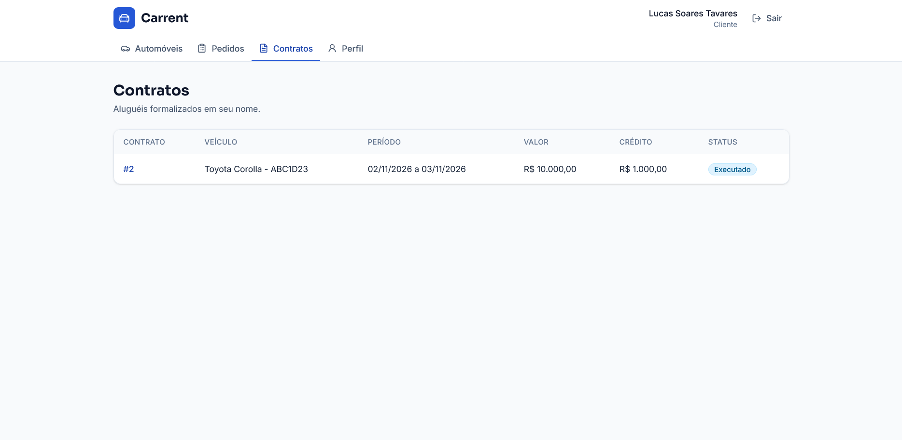 |
| Detalhes do contrato | 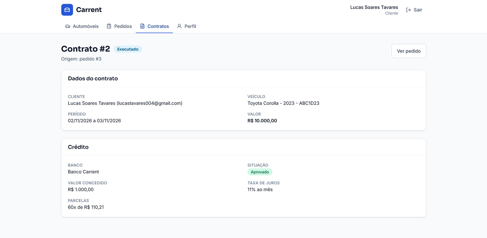 |
| Perfil | 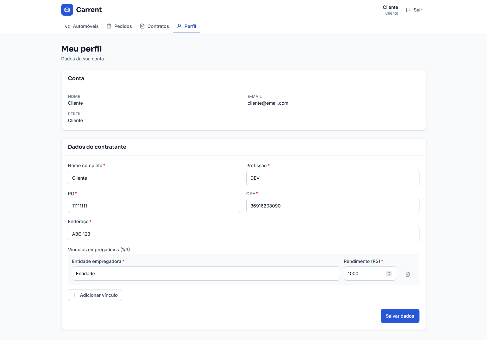 |

### 💻 Exemplo de Saída no Terminal (para Back-end / API)

A API disponibiliza endpoints REST organizados por recursos.

#### 1. Demonstração da API (exemplo com cURL)

Exemplo de cadastro de usuário:

```bash
curl -X POST "http://localhost:8080/api/auth/cadastro" \
  -H "Content-Type: application/json" \
  -d '{
    "nome": "Usuário Exemplo",
    "email": "usuario@exemplo.com"
  }'
```

> O corpo acima é ilustrativo. Consulte os campos obrigatórios de `UsuarioDTO.Cadastro` antes de executar a requisição.

Exemplo de consulta de pedidos (endpoint protegido):

```bash
curl -X GET "http://localhost:8080/api/pedidos" \
  -H "Authorization: Bearer <TOKEN>"
```

#### 2. Principais endpoints identificados

| Método | Endpoint | Responsabilidade |
|---|---|---|
| `POST` | `/api/auth/cadastro` | Cadastro de cliente. |
| `POST` | `/api/auth/login` | Autenticação. |
| `POST` | `/api/auth/logout` | Encerramento de sessão. |
| `GET` | `/api/usuarios/me` | Consulta do perfil autenticado. |
| `PUT` | `/api/usuarios/me/contratante` | Atualização dos dados do contratante. |
| `GET` | `/api/automoveis` | Listagem de automóveis. |
| `GET` | `/api/automoveis/{id}` | Consulta de automóvel. |
| `POST` | `/api/automoveis` | Cadastro de automóvel. |
| `POST` | `/api/pedidos` | Criação de pedido. |
| `GET` | `/api/pedidos` | Listagem de pedidos. |
| `GET` | `/api/pedidos/{id}` | Consulta de pedido. |
| `PUT` | `/api/pedidos/{id}` | Atualização de pedido. |
| `PATCH` | `/api/pedidos/{id}/cancelar` | Cancelamento de pedido. |
| `POST` | `/api/pedidos/{pedidoId}/avaliacoes` | Registro de avaliação. |
| `GET` | `/api/pedidos/{pedidoId}/avaliacoes` | Histórico de avaliações. |
| `POST` | `/api/pedidos/{pedidoId}/contrato` | Formalização de contrato. |
| `GET` | `/api/contratos` | Listagem de contratos. |
| `GET` | `/api/contratos/{id}` | Consulta de contrato. |
| `POST` | `/api/contratos/{contratoId}/credito` | Concessão de crédito. |

Os endpoints protegidos dependem de autenticação e das permissões aplicáveis ao perfil do usuário.

---

## 🧪 Testes

### Testes Unitários e de Integração

O back-end possui estrutura de testes em `backend/src/test/java`. Para executar os testes:

**Windows:**

```powershell
cd backend
.\mvnw.cmd test
```

**Linux/macOS:**

```bash
cd backend
./mvnw test
```

As dependências de teste declaradas no `pom.xml` incluem os módulos de teste do Spring Boot para JPA, Security, Validation e Web MVC.

### Verificação do Front-end

Para executar a análise estática:

```bash
cd frontend
npm run lint
```

Para verificar a compilação TypeScript e gerar o build de produção:

```bash
npm run build
```

### Testes End-to-End (E2E)

O projeto não inclui testes E2E automatizados. A validação do fluxo de utilização é realizada manualmente por meio da aplicação web.

---

## 🔗 Documentações utilizadas

- 📖 **React:** [Documentação oficial](https://react.dev/).
- 📖 **TypeScript:** [Documentação oficial](https://www.typescriptlang.org/docs/).
- 📖 **Vite:** [Documentação oficial](https://vite.dev/guide/).
- 📖 **Tailwind CSS:** [Documentação oficial](https://tailwindcss.com/docs).
- 📖 **React Router:** [Documentação oficial](https://reactrouter.com/).
- 📖 **Java:** [Documentação oficial](https://docs.oracle.com/en/java/).
- 📖 **Spring Boot:** [Documentação oficial](https://docs.spring.io/spring-boot/reference/).
- 📖 **Spring Security:** [Documentação oficial](https://docs.spring.io/spring-security/reference/).
- 📖 **Spring Data JPA:** [Documentação oficial](https://docs.spring.io/spring-data/jpa/reference/).
- 📖 **Maven:** [Documentação oficial](https://maven.apache.org/guides/).
- 📖 **PostgreSQL:** [Documentação oficial](https://www.postgresql.org/docs/).
- 📖 **Supabase:** [Documentação oficial](https://supabase.com/docs).
- 📖 **Docker:** [Documentação oficial](https://docs.docker.com/).
- 📖 **Vercel:** [Documentação oficial](https://vercel.com/docs).
- 📚 **Modelagem do Carrent:** [`docs/MODELING.md`](./docs/MODELING.md).
- 📚 **Histórias de Usuário:** [`docs/USER_STORIES.MD`](./docs/USER_STORIES.MD).

---

## 👥 Autores

| 👤 Nome | :octocat: GitHub | 💼 LinkedIn |
|---|---|---|
| Lucas Soares Tavares | [@tavaresslc](https://github.com/tavaresslc) | [LinkedIn](https://www.linkedin.com/in/tavaresslc/) |

---

## 🤝 Contribuição

Contribuições são bem-vindas. Para colaborar com o projeto:

1. Faça um fork do repositório.
2. Crie uma branch para sua alteração:

   ```bash
   git checkout -b feature/minha-feature
   ```

3. Implemente e teste suas alterações.
4. Faça commit utilizando [Conventional Commits](https://www.conventionalcommits.org/):

   ```bash
   git commit -m "feat: adiciona nova funcionalidade"
   ```

5. Envie sua branch:

   ```bash
   git push origin feature/minha-feature
   ```

6. Abra um Pull Request descrevendo as alterações realizadas.

### Boas práticas

- Mantenha a separação de responsabilidades entre as camadas.
- Evite incluir credenciais e arquivos `.env` no versionamento.
- Execute `npm run lint` e `npm run build` antes de enviar alterações no front-end.
- Execute os testes do Maven antes de enviar alterações no back-end.
- Descreva mudanças relevantes na documentação.

---

## 🙏 Agradecimentos

- **PUC Minas:** pelo ambiente acadêmico e incentivo ao desenvolvimento de projetos de Engenharia de Software.
- **Professores e orientadores:** pelas orientações relacionadas à modelagem, arquitetura, desenvolvimento e documentação de sistemas.
- **Comunidade de desenvolvimento:** pelas documentações, ferramentas e conteúdos que apoiam a construção de aplicações com React, Spring Boot, PostgreSQL e tecnologias relacionadas.

---

## 📄 Licença

Este projeto é distribuído sob a **[Licença MIT](./LICENSE)**.

---
