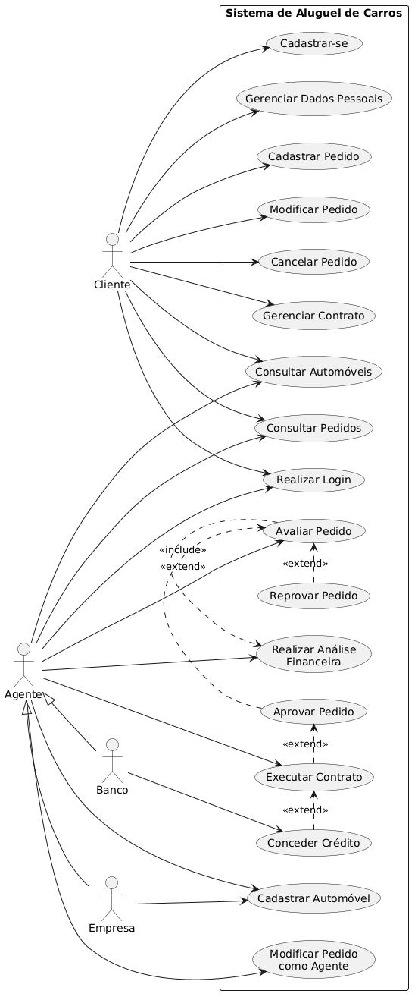
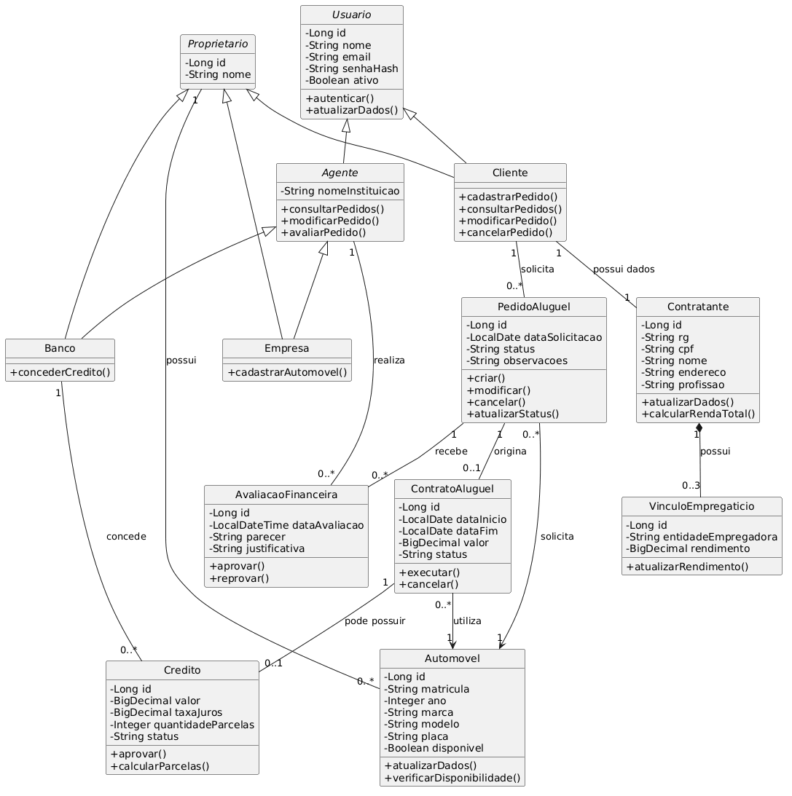
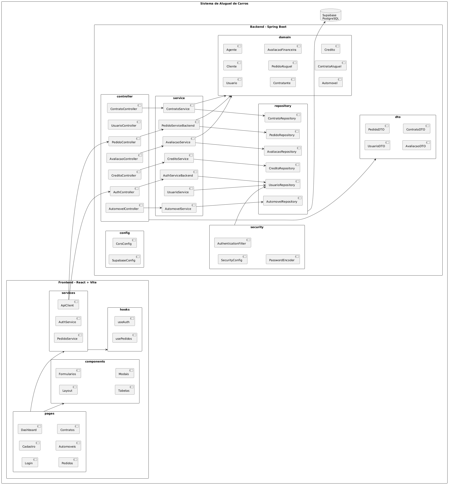

# MODELAGEM

## 1. Definição dos atores e regras de negócio

| Ator/Entidade | Responsabilidade                                                        |
| ------------- | ----------------------------------------------------------------------- |
| Cliente       | Cadastrar-se, autenticar-se e gerenciar seus pedidos de aluguel.        |
| Agente        | Representa empresas e bancos que analisam, avaliam e modificam pedidos. |
| Banco         | Atua como agente e pode conceder contratos de crédito.                  |
| Empresa       | Atua como agente e pode ser proprietária de automóveis.                 |
| Sistema       | Gerencia pedidos, avaliações, contratos e informações dos veículos.     |

**Principais regras de negócio:**

- É obrigatório realizar cadastro e autenticação para utilizar o sistema.
- Um cliente pode criar, consultar, modificar e cancelar seus pedidos.
- Um agente pode consultar, modificar e avaliar pedidos.
- Um pedido precisa passar por avaliação financeira.
- Somente pedidos com parecer financeiro positivo podem avançar para a etapa de contratação.
- Um aluguel pode estar associado a um contrato de crédito.
- O crédito, quando existente, deve ser concedido por um banco agente.
- Um automóvel pode pertencer a um cliente, empresa ou banco.
- Cada contratante pode possuir até três vínculos empregatícios, com seus respectivos rendimentos.

## 2. Diagrama de Casos de Uso

**Atores identificados**

- Cliente;
- Agente (generalização de Empresa e Banco);
- Banco;
- Empresa.

O agente é uma generalização que permite representar funcionalidades comuns às empresas e aos bancos, enquanto o banco possui a responsabilidade adicional de conceder crédito.

### Explicação dos casos de uso

| Caso de uso         | Descrição                                                 |
| ------------------- | --------------------------------------------------------- |
| Cadastrar-se        | Permite que um novo cliente crie uma conta.               |
| RealizarLogin       | Autentica o usuário por meio de usuário e senha.          |
| CadastrarPedido     | Permite solicitar o aluguel de um automóvel.              |
| ModificarPedido     | Permite alterar informações de um pedido existente.       |
| CancelarPedido      | Permite cancelar uma solicitação de aluguel.              |
| AvaliarPedido       | Permite que o agente avalie uma solicitação.              |
| AnáliseFinanceira   | Verifica as informações financeiras do contratante.       |
| AprovarPedido       | Registra um parecer financeiro positivo.                  |
| ReprovarPedido      | Registra um parecer financeiro negativo.                  |
| ExecutarContrato    | Formaliza o contrato após a aprovação.                    |
| ConcederCrédito     | Permite que o banco conceda crédito associado ao aluguel. |
| GerenciarAutomóveis | Permite cadastrar e consultar os veículos disponíveis.    |

Observação: a concessão de crédito é uma funcionalidade exclusiva do banco. A empresa também pode atuar como proprietária de automóveis e agente avaliador.

## 3. Histórias de Usuário

### 3.1. Cadastro e autenticação

| ID   | História do usuário                                                                                    | Prioridade |
| ---- | ------------------------------------------------------------------------------------------------------ | ---------- |
| US01 | Como visitante, quero realizar meu cadastro para ter acesso ao sistema.                                | Alta       |
| US02 | Como usuário cadastrado, quero realizar login com usuário e senha para acessar minhas funcionalidades. | Alta       |
| US03 | Como usuário autenticado, quero encerrar minha sessão para garantir a segurança da minha conta.        | Média      |
| US04 | Como cliente, quero atualizar meus dados pessoais para manter minhas informações atualizadas.          | Média      |

### 3.2. Gerenciamento de pedidos

| ID   | História do usuário                                                                                | Prioridade |
| ---- | -------------------------------------------------------------------------------------------------- | ---------- |
| US05 | Como cliente, quero cadastrar um pedido de aluguel para solicitar um automóvel.                    | Alta       |
| US06 | Como cliente, quero consultar meus pedidos para acompanhar suas situações.                         | Alta       |
| US07 | Como cliente, quero modificar um pedido para corrigir ou atualizar suas informações.               | Alta       |
| US08 | Como cliente, quero cancelar um pedido para desistir de uma solicitação de aluguel.                | Alta       |
| US09 | Como agente, quero consultar os pedidos cadastrados para analisar as solicitações recebidas.       | Alta       |
| US10 | Como agente, quero modificar informações de um pedido para atualizar seus dados durante a análise. | Alta       |

### 3.3. Análise financeira

| ID   | História do usuário                                                                                                    | Prioridade |
| ---- | ---------------------------------------------------------------------------------------------------------------------- | ---------- |
| US11 | Como agente, quero visualizar os dados pessoais e financeiros do contratante para avaliar sua capacidade financeira.   | Alta       |
| US12 | Como agente, quero registrar o resultado da análise financeira para indicar se o pedido foi aprovado ou reprovado.     | Alta       |
| US13 | Como agente, quero consultar o histórico de avaliações para acompanhar as decisões realizadas sobre um pedido.         | Média      |
| US14 | Como cliente, quero acompanhar o resultado da avaliação financeira para saber se meu pedido foi aprovado ou reprovado. | Alta       |

### 3.4. Contratos e crédito

| ID   | História do usuário                                                                                 | Prioridade |
| ---- | --------------------------------------------------------------------------------------------------- | ---------- |
| US15 | Como agente, quero encaminhar pedidos aprovados para execução contratual para formalizar o aluguel. | Alta       |
| US16 | Como cliente, quero consultar meus contratos para acompanhar os aluguéis formalizados.              | Média      |
| US17 | Como banco, quero conceder crédito associado a um aluguel para viabilizar sua contratação.          | Alta       |
| US18 | Como agente, quero consultar os contratos para acompanhar sua execução.                             | Média      |

### 3.5. Automóveis e informações financeiras

| ID   | História do usuário                                                                                                                           | Prioridade |
| ---- | --------------------------------------------------------------------------------------------------------------------------------------------- | ---------- |
| US19 | Como agente, quero cadastrar automóveis para disponibilizá-los no sistema.                                                                    | Alta       |
| US20 | Como usuário, quero consultar os automóveis cadastrados para conhecer os veículos disponíveis.                                                | Alta       |
| US21 | Como contratante, quero cadastrar meus dados profissionais para comprovar minha renda.                                                        | Alta       |
| US22 | Como contratante, quero cadastrar até três vínculos empregatícios com seus respectivos rendimentos para apresentar minha situação financeira. | Alta       |
| US23 | Como agente, quero visualizar os proprietários dos automóveis para identificar a titularidade dos veículos.                                   | Média      |

### 3.6. Critérios de aceitação das principais histórias

US05 - Cadastrar pedido

- O cliente precisa estar autenticado.
- O pedido deve estar associado ao cliente que o cadastrou.
- Deve ser possível selecionar um automóvel.
- O pedido deve receber um identificador único.
- O pedido deve iniciar com status `PENDENTE`.

US07 - Modificar pedido

- O cliente só pode modificar seus próprios pedidos.
- Pedidos cancelados ou com contrato executado não podem ser modificados.
- As alterações devem ser persistidas no banco de dados.

US12 - Registrar avaliação financeira

- Somente agentes autenticados podem avaliar pedidos.
- A avaliação deve estar vinculada a um pedido.
- Deve ser registrado o resultado da avaliação.
- O resultado deve ser positivo ou negativo.
- Uma aprovação deve permitir o encaminhamento para contratação.

US22 - Cadastrar vínculos empregatícios

- O contratante pode possuir no máximo três vínculos.
- Cada vínculo deve possuir uma entidade empregadora e um rendimento.
- Não deve ser permitido cadastrar um quarto vínculo.

## 4. Diagrama de Classes

A modelagem considera os seguintes conceitos:

- `Usuario`: estrutura básica de autenticação.
- `Cliente`: representa o usuário que solicita aluguéis.
- `Agente`: representa empresas e bancos responsáveis pelas avaliações.
- `Empresa` e `Banco`: especializações de agente.
- `Contratante`: contém os dados pessoais e profissionais utilizados na contratação.
- `VinculoEmpregaticio`: representa a relação entre o contratante e uma entidade empregadora.
- `PedidoAluguel`: representa a solicitação de aluguel.
- `AvaliacaoFinanceira`: registra a avaliação realizada pelo agente.
- `ContratoAluguel`: representa a formalização do aluguel.
- `Automovel`: contém os dados dos veículos.
- `Credito`: representa o financiamento concedido por um banco.

### Explicação dos relacionamentos

| Relacionamento                     | Cardinalidade | Justificativa                                   |
| ---------------------------------- | ------------- | ----------------------------------------------- |
| Usuario > Cliente                  | Herança       | Cliente é um tipo de usuário.                     |
| Usuario > Agente                   | Herança       | Agente também precisa autenticar-se.            |
| Agente > Empresa                   | Herança       | Empresa é um tipo de agente.                    |
| Agente > Banco                     | Herança       | Banco é um tipo de agente.                      |
| Contratante > Vínculo empregatício | 1 para 0..3   | Um contratante pode ter até três vínculos.      |
| Cliente > Contratante              | 1 para 1      | Cada cliente possui um contratante associado.   |
| Cliente > Pedido                   | 1 para N      | Um cliente pode realizar diversos pedidos.      |
| Pedido > Avaliação                 | 1 para N      | Um pedido pode receber avaliações.              |
| Agente > Avaliação                 | 1 para N      | Um agente pode realizar diversas avaliações.    |
| Pedido > Automóvel                 | N para 1      | Cada pedido solicita um automóvel.              |
| Pedido > Contrato                  | 1 para 0..1   | Um pedido pode originar um contrato.            |
| Contrato > Crédito                 | 1 para 0..1   | Um contrato pode possuir um crédito associado.  |
| Banco > Crédito                    | 1 para N      | Um banco pode conceder diversos créditos.       |
| Proprietário > Automóvel           | 1 para N      | Um proprietário pode possuir vários automóveis. |

### Decisões importantes de modelagem

1. **Por que existe a classe Proprietario?**

O requisito determina que um automóvel pode pertencer a um cliente, uma empresa ou um banco.

Em vez de criar três relacionamentos independentes na classe `Automovel`, utilizamos uma classe abstrata `Proprietario`, especializada por essas três classes.

Isso permite representar a propriedade de maneira mais organizada.

2. **Por que Contratante é diferente de Cliente?**

O cliente é o usuário responsável por acessar e operar o sistema. Já o contratante representa os dados pessoais e financeiros utilizados na formalização do aluguel.

Essa separação permite que as informações contratuais sejam organizadas independentemente das credenciais de acesso.

3. **Por que existe VinculoEmpregaticio?**

Porque o requisito estabelece que cada contratante pode possuir até três entidades empregadoras e seus respectivos rendimentos.

A classe separada permite armazenar cada vínculo individualmente, evitando criar atributos repetidos como `empresa1`, `empresa2`, `empresa3`.

4. **Por que AvaliacaoFinanceira é uma classe independente?**

Porque o sistema precisa registrar quem realizou a avaliação, quando ela ocorreu e qual foi o parecer.

Assim, também é possível manter um histórico de avaliações de um pedido.

## 5. Diagrama de Pacotes

### Responsabilidade de cada pacote

**Frontend - React + Vite**

| Pacote       | Responsabilidade                                                                       |
| ------------ | -------------------------------------------------------------------------------------- |
| `pages`      | Telas principais da aplicação, como login, cadastro, pedidos e contratos.              |
| `components` | Componentes reutilizáveis, como formulários, tabelas, modais e layouts.                |
| `services`   | Comunicação HTTP com a API Spring Boot.                                                |
| `hooks`      | Encapsulamento de estados e comportamentos reutilizáveis, como autenticação e pedidos. |

**Backend - Spring Boot**

O backend utiliza a arquitetura MVC, complementada por uma camada de serviços e repositórios.

| Pacote     | Responsabilidade                                                       |
| ---------- | ---------------------------------------------------------------------- |
| controller | Receber requisições HTTP e disponibilizar os endpoints REST.           |
| service    | Implementar as regras de negócio e orquestrar as operações.            |
| domain     | Representar as entidades e os conceitos centrais do sistema.           |
| repository | Realizar operações de persistência e consulta no banco de dados.       |
| security   | Gerenciar autenticação, autorização e proteção dos endpoints.          |
| dto        | Definir os objetos utilizados na comunicação entre frontend e backend. |
| config     | Centralizar configurações de integração, CORS e infraestrutura.        |

**Banco de dados - Supabase PostgreSQL**

O Supabase será responsável pelo armazenamento persistente das informações:

- Usuários e credenciais;
- Dados dos contratantes;
- Vínculos empregatícios;
- Pedidos de aluguel;
- Avaliações financeiras;
- Automóveis e proprietários;
- Contratos de aluguel;
- Contratos de crédito.
